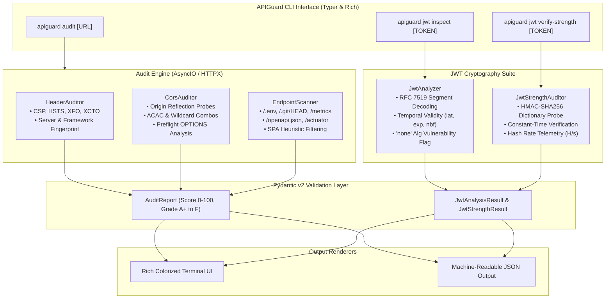

# APIGuard CLI

[](https://python.org)
[](https://opensource.org/licenses/MIT)
[](https://docs.pytest.org)
[](https://github.com/psf/black)
[](https://www.python-httpx.org/)

> **APIGuard** is a high-performance, asynchronous CLI utility engineered for modern REST API compliance auditing, black-box security configuration verification, and cryptographic JWT inspection.

---

## Overview

Modern web APIs frequently suffer from subtle configuration drifts that escape traditional unit tests: permissive CORS policies reflecting untrusted origins, missing browser defense-in-depth headers, exposed diagnostic or metrics routes, and weakly signed JSON Web Tokens (JWTs).

**APIGuard** bridges the gap between infrastructure deployment and security compliance. Built with **Python 3.11+**, **Pydantic v2**, **HTTPX**, **Typer**, and **Rich**, APIGuard provides automated, non-invasive auditing for engineers, SREs, and AppSec teams in CI/CD pipelines and production environments.

---

## Architecture



---

## Key Features

- 🛡️ **HTTP Security Headers Compliance**: In-depth inspection of `Content-Security-Policy`, `Strict-Transport-Security` (duration, subdomains, preload), `X-Content-Type-Options`, `X-Frame-Options`, `Referrer-Policy`, and server software banner leaks.
- 🌐 **CORS Configuration Auditing**: Probing endpoints against untrusted and `null` origins to detect dangerous combinations, such as reflected origins with `Access-Control-Allow-Credentials: true` and preflight wildcard permissions.
- 🔍 **Diagnostic & Metadata Route Exposure**: Concurrently scans for exposed `.env` files, `.git/HEAD` repositories, Prometheus `/metrics`, Spring Boot `/actuator`, and OpenAPI/Swagger documentation, with built-in heuristic filtering to discard Single Page Application (SPA) false positives.
- 📋 **JWT Structure & Claims Inspection**: Decodes and verifies header parameters (`alg`, `typ`, `kid`) and payload claims without requiring signing keys. Flags dangerous `alg: "none"` bypasses, missing expiration dates, clock skew, and cleartext credentials in claims.
- ⚡ **HMAC Cryptographic Resilience Benchmark**: Verifies token resistance against high-frequency dictionary attacks using constant-time comparison (`hmac.compare_digest`), reporting real-time hash rates ($H/s$) and elapsed execution times.
- 🎨 **Executive Rich UI & JSON Pipeline**: Visual color-coded terminals with compliance letter grades ($A+$ through $F$), actionable remediation tips, and `--format json` output for CI/CD gating.

---

## Installation

### Option 1: Via Pip / Local Clone (Recommended)

```bash
git clone https://github.com/organization/apiguard-cli.git
cd apiguard-cli

# Create and activate virtual environment
python -m venv .venv
source .venv/bin/activate  # On Windows: .venv\Scripts\activate

# Install in editable mode
pip install -e .
```

### Option 2: Via Docker

```bash
# Build the Docker image
docker build -t apiguard:latest .

# Run APIGuard inside container
docker run --rm apiguard:latest --help
docker run --rm apiguard:latest audit https://api.example.com
```

---

## Quick Start & CLI Usage

### 1. Audit a REST API Endpoint

Perform an automated audit on security headers, CORS policies, and diagnostic endpoints:

```bash
apiguard audit https://api.example.com
```

#### Custom Options:
```bash
# Export results to JSON for CI/CD gates
apiguard audit https://api.example.com --format json --output report.json

# Probe additional custom endpoints with custom concurrency
apiguard audit https://api.example.com --path /v1/debug --path /internal/config --concurrency 10
```

### 2. Inspect a JSON Web Token (JWT)

Decode and analyze JWT claims, expiration timestamps, and algorithms:

```bash
apiguard jwt inspect "eyJhbGciOiJIUzI1NiIsInR5cCI6IkpXVCJ9..."
```

### 3. Verify HMAC-SHA256 Token Strength

Test token signing keys against common weak dictionary secrets:

```bash
# Using built-in dictionary
apiguard jwt verify-strength "eyJhbGciOiJIUzI1NiIsInR5cCI6IkpXVCJ9..."

# Using a custom wordlist
apiguard jwt verify-strength "eyJhbGciOiJIUzI1NiIsInR5cCI6IkpXVCJ9..." --wordlist /path/to/wordlist.txt
```

---

## Terminal Output Preview

### API Audit Report

```text
   █████╗ ██████╗ ██╗ ██████╗ ██╗   ██╗ █████╗ ██████╗ ██████╗ 
  ██╔══██╗██╔══██╗██║██╔════╝ ██║   ██║██╔══██╗██╔══██╗██╔══██╗
  ███████║██████╔╝██║██║  ███╗██║   ██║███████║██████╔╝██║  ██║
  ██╔══██║██╔═══╝ ██║██║   ██║██║   ██║██╔══██║██╔══██╗██║  ██║
  ██║  ██║██║     ██║╚██████╔╝╚██████╔╝██║  ██║██║  ██║██████╔╝
  ╚═╝  ╚═╝╚═╝     ╚═╝ ╚═════╝  ╚═════╝ ╚═╝  ╚═╝╚═╝  ╚═╝╚═════╝ 
  Automated REST API Health & Security Compliance Linter v0.1.0

┏━━━━━━━━━━━━━━━━━━━━━━━━━━━━━━━━━ EXECUTIVE AUDIT SUMMARY ━━━━━━━━━━━━━━━━━━━━━━━━━━━━━━━━━┓
┃ Target: https://api.target-service.com                                                     ┃
┃ Compliance Score: 77/100 [C]                                                              ┃
┃ Scan Duration: 0.84s  •  Findings: CRIT:0  HIGH:1  MED:2  LOW:0  PASS:4                    ┃
┗━━━━━━━━━━━━━━━━━━━━━━━━━━━━━━━━━━━━━━━━━━━━━━━━━━━━━━━━━━━━━━━━━━━━━━━━━━━━━━━━━━━━━━━━━━━┛

🛡️  HTTP Security Headers Compliance
┏━━━━━━━━━━━━━━━━━━━━━━━━━━━┳━━━━━━━━━━┳━━━━━━━━━━┳━━━━━━━━━━━━━━━━━━━━━━━━━━━┳━━━━━━━━━━━━━━━━━━━━━━━━━━━━━━━━━━━━━┓
┃ Header                    ┃ Status   ┃ Severity ┃ Configured Value          ┃ Details & Guidance                  ┃
┣━━━━━━━━━━━━━━━━━━━━━━━━━━━╋━━━━━━━━━━╋━━━━━━━━━━╋━━━━━━━━━━━━━━━━━━━━━━━━━━━╋━━━━━━━━━━━━━━━━━━━━━━━━━━━━━━━━━━━━━┫
┃ Content-Security-Policy   ┃ FAILED   ┃ HIGH     ┃ MISSING                   ┃ Missing CSP header.                 ┃
┃                           ┃          ┃          ┃                           ┃ Tip: Configure a strict CSP.        ┃
┃ Strict-Transport-Security ┃ PASSED   ┃ PASS     ┃ max-age=31536000; incl... ┃ Compliant HSTS configured.          ┃
┃ X-Content-Type-Options    ┃ PASSED   ┃ PASS     ┃ nosniff                   ┃ nosniff directive enforced.         ┃
┃ X-Frame-Options           ┃ PASSED   ┃ PASS     ┃ DENY                      ┃ Anti-clickjacking configured.       ┃
┃ Referrer-Policy           ┃ WARNING  ┃ LOW      ┃ MISSING                   ┃ Missing Referrer-Policy header.     ┃
┃ Permissions-Policy        ┃ WARNING  ┃ LOW      ┃ MISSING                   ┃ Browser hardware APIs unshielded.   ┃
┗━━━━━━━━━━━━━━━━━━━━━━━━━━━┻━━━━━━━━━━┻━━━━━━━━━━┻━━━━━━━━━━━━━━━━━━━━━━━━━━━┻━━━━━━━━━━━━━━━━━━━━━━━━━━━━━━━━━━━━━┛

🌐  Cross-Origin Resource Sharing (CORS) Audit
┏━━━━━━━━━━━━━━━━━━━━━━━━━━┳━━━━━━━━━━━━━━━━━━━━━━━━━━┳━━━━━━━━━━┳━━━━━━━━━━┳━━━━━━━━━━━━━━━━━━━━━━━━━━━━━━━━━━━━━━━┓
┃ Probe Origin             ┃ ACAO Response            ┃ ACAC     ┃ Severity ┃ Evaluation                            ┃
┣━━━━━━━━━━━━━━━━━━━━━━━━━━╋━━━━━━━━━━━━━━━━━━━━━━━━━━╋━━━━━━━━━━╋━━━━━━━━━━╋━━━━━━━━━━━━━━━━━━━━━━━━━━━━━━━━━━━━━━━┫
┃ https://evil.example.com ┃ None                     ┃ -        ┃ PASS     ┃ SOP enforced. Untrusted probe ignored.┃
┃ null                     ┃ None                     ┃ -        ┃ PASS     ┃ Strict SOP maintained for null origin.┃
┃ OPTIONS Preflight        ┃ None                     ┃ -        ┃ PASS     ┃ Preflight methods strictly scoped.    ┃
┗━━━━━━━━━━━━━━━━━━━━━━━━━━┻━━━━━━━━━━━━━━━━━━━━━━━━━━┻━━━━━━━━━━┻━━━━━━━━━━┻━━━━━━━━━━━━━━━━━━━━━━━━━━━━━━━━━━━━━━━┛

🔍  Exposed Metadata & Sensitive Endpoints
┏━━━━━━━━━━━━━━━━━━━━━━━━┳━━━━━━━━━━━━━━┳━━━━━━━━━━━━┳━━━━━━━━━━┳━━━━━━━━━━━━━━━━━━━━━━━━━━━━━━━━━━━━━━━━━━━━━━━━━━━┓
┃ Path                   ┃ Status Code  ┃ Exposed?   ┃ Severity ┃ Risk & Remediation                                ┃
┣━━━━━━━━━━━━━━━━━━━━━━━━╋━━━━━━━━━━━━━━╋━━━━━━━━━━━━╋━━━━━━━━━━╋━━━━━━━━━━━━━━━━━━━━━━━━━━━━━━━━━━━━━━━━━━━━━━━━━━━┫
┃ /.env                  ┃ 404          ┃ NO         ┃ PASS     ┃ Route unexposed.                                  ┃
┃ /.git/HEAD             ┃ 404          ┃ NO         ┃ PASS     ┃ Route unexposed.                                  ┃
┃ /metrics               ┃ 404          ┃ NO         ┃ PASS     ┃ Prometheus metrics not publicly exposed.          ┃
┃ /openapi.json          ┃ 200          ┃ YES        ┃ LOW      ┃ OpenAPI spec reachable without authentication.    ┃
┗━━━━━━━━━━━━━━━━━━━━━━━━┻━━━━━━━━━━━━━━┻━━━━━━━━━━━━┻━━━━━━━━━━┻━━━━━━━━━━━━━━━━━━━━━━━━━━━━━━━━━━━━━━━━━━━━━━━━━━━┛
```

---

## Test Suite

APIGuard includes a comprehensive unit and integration test suite using `pytest` and `pytest-asyncio` with fully mocked network layers (`httpx.MockTransport`).

```bash
# Run pytest test suite
pytest -v
```

```text
============================= test session starts ==============================
platform win32 -- Python 3.14.7, pytest-9.1.1, pluggy-1.6.0
rootdir: D:\projects\aegis-api\apiguard-cli
configfile: pyproject.toml
testpaths: tests
plugins: anyio-4.15.1, asyncio-1.4.0
asyncio: mode=Mode.AUTO
collected 33 items

tests/test_cli.py .........                                              [ 27%]
tests/test_cors.py ....                                                  [ 39%]
tests/test_endpoints.py .....                                            [ 54%]
tests/test_headers.py ......                                             [ 72%]
tests/test_jwt.py .........                                              [100%]

============================== 33 passed in 0.30s ==============================
```

---

## Security & Compliance Disclaimer

APIGuard is designed strictly for **authorized security audits**, defensive posture evaluation, and automated compliance verification in development and production environments. Always obtain explicit written permission from system owners prior to running audits against external or third-party APIs.

---

## License

This project is licensed under the terms of the [MIT License](LICENSE).
